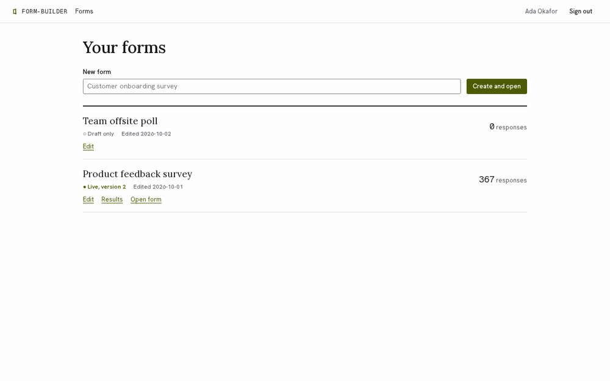
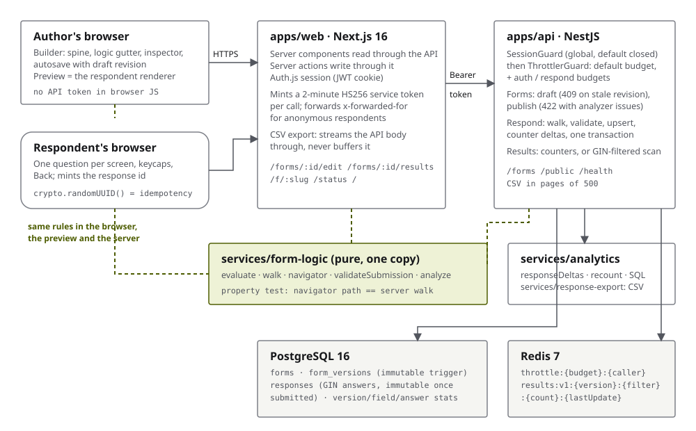

# form-builder: forms whose branching you can see, and a server that enforces it

[](https://github.com/bastian-red/form-builder/actions/workflows/ci.yml)

A Typeform-style form builder. Authors compose questions on a single numbered spine with every
logic jump drawn as a connector beside it. Respondents answer one question per screen, by keyboard
or thumb. The report stays fast at 100,000 responses. Next.js 16 and NestJS over PostgreSQL and
Redis, with one pure logic engine shared by the builder, the respondent's browser and the API.





## The hard part: conditional logic that means the same thing everywhere

A form with branching is a small program. "Show *Team size* only if *Role* is Manager", "after the
NPS question, jump to *What should we improve* when the score is below 7". That program runs in
three places: the builder's live preview, the respondent's browser and the server. If any two of
them disagree about what a rule means, the results contain answers that should not exist.

Here all three run **one package**, `services/form-logic`:

- `evaluate`: a typed condition AST (`all`, `any`, `not`, `eq`, `includes`, `lt`...). Its rules
  are chosen so a skipped question never routes anyone somewhere surprising. A comparison on an
  unanswered question is false, `neq` included.
- `walk`: the path a set of answers produces. Jumps only go forward, so it terminates by
  construction. It also refuses a backward target at runtime rather than trusting the analyzer.
- the navigator: what the respondent's screen uses, one question at a time, with Back. Back keeps
  answers to the branch being left, so they are pruned before anything is sent.
- `validateSubmission`: what the API runs on every save. It walks the answers itself and refuses
  an answer to a question those answers route around (`hidden_answered`), a required question
  left empty, or a value the question does not accept.
- `analyze`: what blocks Publish. Backward jumps, references to deleted questions, comparisons that
  cannot work (`includes` on a number), conditions on statements. Each issue names both ends of the
  edge, so the builder draws that connector broken.

A **property test** generates thousands of forms and respondents who answer, skip and go Back to
change branch. For every one, the server's walk must reproduce the navigator's path exactly. The
honest submission must be accepted, and a smuggled answer to an unshown question must be refused.
The first version of that test passed against a navigator that read stale answers, because the
generated forms almost never left any. Now it asserts that the case it exists for actually occurs
(209 of 2,000 runs), and that planted bug fails it in two moves.

## What it has to get right, and the test that holds each

| Claim | Held by |
|---|---|
| The server accepts only what the client logic could produce | `navigator.property.test.ts` (2,000 generated respondents), `apps/api/test/respond.test.ts` |
| A form cannot loop | `analyze.test.ts`; publishing a backward jump answers `422` naming the edge (`forms.test.ts`, E2E) |
| Editing a form never rewrites an old response | responses pin `form_version_id`; a trigger refuses any `UPDATE` of a published version; per-version results and CSV (`versions.spec.ts`) |
| A retried save is one row | 20 concurrent identical `PUT`s, one row (`respond.test.ts`) |
| A submitted response is final | the upsert's `WHERE submitted_at IS NULL`, plus a trigger that refuses any later `UPDATE` |
| Two tabs never overwrite each other's draft | `PUT /forms/:id/draft` carries the revision it was based on, `409` otherwise (`forms.test.ts`, E2E) |
| Results stay fast | 100,000 completed responses: unfiltered p95 **61–98 ms** (budget 150), filtered p95 **389–581 ms** (budget 1,500), measured across runs (`scale.test.ts`) |
| The results counters never drift from the rows | after concurrent traffic, a full recount equals the incremental counters (`respond.test.ts`, property test in `counters.test.ts`) |
| Rate limits apply where they are meant to | the 5/min sign-in budget refuses the sixth attempt and does **not** limit the form list (`auth.test.ts`) |
| `pnpm dev` works from a fresh clone | `scripts/dev-smoke.sh`, with every `.env` name stripped from its environment |

## Results without scanning every response

The first design aggregated the report from the answers JSONB on every view: `jsonb_each`, group
by key and value. At 100,000 responses it measured p95 648 ms, and single-pass rewrites only got it
to about 400 ms. Any design that re-reads every answer per view is O(responses).

So each save writes **counter deltas** in the same transaction as the response: started,
completed, reached per question (for the funnel), answered per question, one count per
categorical value, and the duration in whole seconds. An unfiltered report reads those rows, which
is O(distinct answers) whatever the response count. A **filtered** report ("only Managers") can't
use counters, so it scans the rows that the `jsonb_path_ops` GIN index selects for
`answers @> '{"f_role":"o_manager"}'`. That result is cached in Redis under a key containing the
version's response count and last update time, so it never needs invalidating.

Two Postgres behaviours this ran into, each now behind a test:

- **A CHECK is evaluated on the row an upsert *proposes*, before `ON CONFLICT` sees the existing
  one.** Completing a response proposes `(started 0, completed 1)` and fails
  `completed <= started` against a row that has started 320. Counter decrements (a respondent goes
  Back and a question leaves their path) are `UPDATE`s for the same reason.
- **`now()` is when the transaction began.** Under concurrent saves, one that began before the
  row's inserter and then waited on its lock stamped an `updated_at` earlier than `started_at`.
  The CHECK refused it, and the test that hammers one response id with 20 saves found it.

`pnpm db:recount` rebuilds every version's counters from the responses under an exclusive advisory
lock that saves take in shared mode. It is the repair tool, and the seed uses it.

## The design: three surfaces, one product

The builder is a white, ruled drafting sheet: dense type, a 3px radius, an olive accent that
belongs to the logic. A connector in the gutter, a rule in the inspector and the selected block
all share that colour. The respondent's page is apricot paper with ochre, one question at a time
in Lora at display size, 48px targets, keycaps for A/B/C and Y/N, and a progress bar that also
says "3 of 10". The report is a long document: a KPI row, where people stop, then one card per
question with the chart its data calls for (bars for choices, columns for ratings, a diverging
bar for NPS, a meter for yes/no) and a table behind every chart.

Every pair of colours clears WCAG AA in both schemes, checked against the real stylesheets by
`apps/web/lib/contrast.test.ts`. The accent and the error red are nearly the same grey, so every
error carries a ✕ and a sentence, and the test pins that collapse. axe runs over every route in
both schemes with zero violations.

## Running it

Requirements: Node 20, pnpm 9, Docker.

```bash
git clone https://github.com/bastian-red/form-builder.git
cd form-builder
pnpm install

cp .env.example .env
sed -i "s|^AUTH_SECRET=|AUTH_SECRET=$(openssl rand -base64 32)|" .env

docker compose -f infra/docker-compose.yml up -d   # Postgres :5441, Redis :6387
pnpm db:deploy
pnpm db:seed

pnpm dev    # web :3000, api :4000
```

Open http://localhost:3000 and sign in as `ada@forms.test` / `demo-password-2026`. "Product
feedback survey" has two published versions and 460 seeded responses. Answer it yourself at
http://localhost:3000/f/product-feedback, in a private window or signed out.

The whole stack in containers, migrated and seeded:

```bash
docker compose -f infra/docker-compose.yml --profile app up -d --build
```

`pnpm dev` goes through `scripts/dev.sh`, which loads `.env`, checks `AUTH_SECRET`, checks that
Postgres and Redis answer, and then starts turbo. Turbo runs in strict environment mode and reads
no `.env` on its own, so running `turbo run dev` directly would start an API with no secret.

## Testing

| Lane | Command | What it needs |
|---|---|---|
| Gate (pre-commit) | `pnpm test` | nothing; seconds |
| Environment contract | `pnpm env:contract` | nothing |
| Integration | `./scripts/integration.sh` | Postgres, Redis; includes the 100k-row scale test |
| Database drift | `pnpm db:drift` | a migrated database |
| Seed determinism | `pnpm db:seed:check` | a database |
| Dev smoke | `./scripts/dev-smoke.sh` | datastores up; runs the documented `pnpm dev` |
| E2E + accessibility | `./scripts/e2e.sh` | datastores up; Chromium and Firefox |
| Demo GIF | `./scripts/demo-gif.sh` | ffmpeg, ImageMagick |

The pre-commit hook runs gitleaks, the environment contract, the invisible-character scan and the
gate lane. CI runs every lane on every push and builds both Docker images.

## Configuration

Every variable is documented in [`.env.example`](.env.example) and declared in `turbo.json`.
`scripts/env-contract.mjs` fails the commit when the source, `.env.example` and `turbo.json`
disagree.

## Layout

```
apps/web               Next.js: builder, respondent page, report, /status
apps/api               NestJS: auth, forms, publish, respond, results, export, /health
services/form-logic    the logic engine: evaluate, walk, navigator, validate, analyze
services/analytics     counter deltas, recount, the aggregation SQL, the filtered-results cache
services/response-export  streamed CSV with formula-injection guard
packages/db            Prisma schema, migrations, invariants, seed
packages/shared        zod contracts: form definition, API shapes, errors
e2e                    Playwright
infra                  Dockerfiles and docker-compose.yml
```
